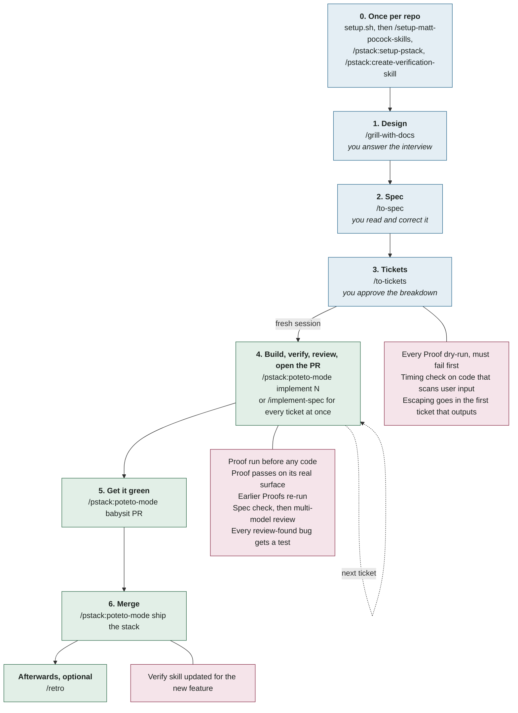

# pocoteto

Matt Pocock's skills and poteto's pstack, working as one pipeline. This bundle holds Matt's skills with the pocoteto patches. pstack comes from the **pstack-claude plugin**, installed unchanged; the pstack-side changes live in `AGENTS-snippet.md`, a CLAUDE.md block the plugin follows.

Matt's skills own alignment: interviewing you, a shared glossary, a spec, and tickets. pstack owns execution: playbooks, delegation, proof on the real surface, adversarial review, and merging. The two packs had no handoff between them. This bundle adds one, the **Proof** line, and resolves the places where the packs collided.

## Install into a repo

From the repo's root:

```bash
curl -fsSL https://raw.githubusercontent.com/moedesux/pocoteto-skills/main/setup.sh | bash
```

That puts Matt's skills in `.claude/skills/`, declares the pinned pstack plugin in `.claude/settings.json`, and adds the pocoteto rules to `CLAUDE.md`. It also adds `.scratch/` to `.gitignore`, so the local tracker and process notes stay off feature branches. Commit those, so every clone gets the same setup. The settings don't install pstack by themselves, in interactive or headless sessions, so each machine installs it once by command (step 1 below). Re-run it any time to update.

Then open Claude Code in the repo:

1. Install the pstack plugin, once per machine. Claude Code doesn't offer it by itself, even with the repo settings in place. Type `/plugin marketplace add michael-denyer/pstack-claude#v0.9.84`, then `/plugin install pstack@pstack-claude`, then `/reload-plugins`. Headless or cloud agent: `claude plugin marketplace add michael-denyer/pstack-claude#v0.9.84 --scope project`, then `claude plugin install pstack@pstack-claude --scope project`.
2. `/setup-matt-pocock-skills` (tracker, labels, glossary location)
3. `/pstack:setup-pstack` (models per role)
4. `/pstack:create-verification-skill` (a project `verify` skill the Proof checks use)
5. Start a feature with `/grill-with-docs` (see How you use it), or type `/flow` if you're not sure where to begin.

If you had the old marketplace `mattpocock-skills` plugin, uninstall it so Matt's skills don't load twice.

Agents: see [AGENTS.md](AGENTS.md).

**For all your repos instead of one:** `./install.sh` installs the skills user-wide (`~/.claude/skills`). You still need the plugin and the `CLAUDE.md` block per repo, so `setup.sh` is usually the better choice.

## How you use it

Six commands take a feature from idea to merged PR. You answer questions in the first three. From the fourth on, the work runs by itself and stops at the gates (red below) until they pass.



| # | You type | You do | Runs by itself |
| --- | --- | --- | --- |
| 0 | `setup.sh`, then `/setup-matt-pocock-skills`, `/pstack:setup-pstack`, `/pstack:create-verification-skill` | Pick a tracker, a model per role, and how to check the app works | Skills, rules and the project `verify` skill |
| 1 | `/grill-with-docs`, then describe the feature | Answer until every decision is made | `GLOSSARY.md` terms, ADRs |
| 2 | `/to-spec` | Read it, correct it | The spec, filed on the tracker |
| 3 | `/to-tickets` | Approve the breakdown | A shape sketch, then tickets with a **Proof** and a **Touches** line each |
| 4 | `/pstack:poteto-mode implement #<n>` (one ticket), or `/implement-spec` (all of them) | Read what it reports | Build, Proof on the real surface, code review, multi-model review, small commits, PR |
| 5 | `/pstack:poteto-mode babysit <pr>` | Leave it running | Conflicts, review comments, failing CI |
| 6 | `/pstack:poteto-mode ship the stack`, or merge yourself | Typing it is your go-ahead | Re-check each PR, merge bottom-up, then update the `verify` skill if a feature shipped |

Run steps 1 to 3 in one session, and start a fresh one for step 4. With one ticket at a time, repeat step 4 for each ticket.

**When to type `/flow`.** The six commands above don't need it. Type `/flow` when you're not sure where you are, or when you start from something else: a bug, a slow path, an incoming issue, someone else's branch. It answers with the next command. In an unattended run it runs that command itself. The rules that matter after a merge don't depend on `/flow`: they are in the `CLAUDE.md` block, which every session reads.

### Gates pocoteto adds

Neither pack enforces these on its own. Each one stops the work until it passes.

| Where | Gate |
| --- | --- |
| Tickets | Every Proof is dry-run when it's written. It must fail for the predicted reason, and a check that selects zero tests is broken. |
| Tickets | A ticket that adds a regex or scanner over user input carries a timing check on a large hostile input (at least 64 KB). |
| Tickets | Escaping user input belongs to the first ticket that outputs it, never a later hardening ticket. |
| Build | The Proof runs before any code. Already green means verify-only, never auto-close. |
| Build | A contradiction with another ticket's criterion stops the work. Tickets on the same seam never build in parallel. |
| Verify | Done means the Proof passes on the surface it names. Closing a ticket re-runs every earlier Proof. |
| Review | `code-review` with its Spec check, then `interrogate` (multi-model attack) for any nontrivial change: once per ticket, or once over the branch when tickets ship together. |
| Review | A new option or extra is tested switched on together with each existing one. |
| Review | Every bug a reviewer finds lands with a test that fails without its fix. |
| Review | No independent reviewer available means one labelled self-review, `BLOCKED: independent review`, and never merge-ready. |
| Design | In an interview the agent runs on itself, questions about code mechanism stay open for the build's design step (`architect` or arena) instead of being settled as assumptions. |
| Ship | A user-facing feature adds its entry to the `verify` skill's feature map, and after a merge `/pstack:maintain-verification-skill` keeps the whole map current. |
| Branch | Tickets in `.scratch/`, interview notes and the retro stay off the feature branch. |

## Upstream

| Pack | Source | How |
| --- | --- | --- |
| Matt Pocock skills | `github.com/mattpocock/skills` (engineering + productivity), pinned `49dd158` | Files in `skills/`, rebuilt by `rebuild.sh` from `patches/` |
| pstack | `michael-denyer/pstack-claude` plugin (community Claude Code port), pinned to release tag `v0.9.84` (commit `990cd7b`) | Installed as a plugin from the marketplace at that tag (`PSTACK_REF` in `setup.sh`). Not in this bundle. |

Neither pack follows upstream HEAD. Updates come in only when someone bumps a pin after reading the upstream diff (see Updating).

Both are MIT.

> The "What changed" tables below describe the original all-in-one bundle. In this version the pstack-side rows (`/explain` rename, poteto-mode and playbook edits, the `correct` table location, poteto-help links) are rules in `AGENTS-snippet.md` instead of file edits, and pstack's one-shot explainer is `/pstack:teach`.

All changes to Matt's skills live in `patches/` as small commits, so you can read each one on its own.

## What changed

### Collisions resolved

| Problem | Fix |
| --- | --- |
| Both packs ship a skill named `tdd` | Kept Matt's, which covers features and bugs. pstack's bug-fix guardrails moved into it: skip a test that would be bad, use the closest executable check, report red-then-green evidence. |
| Both packs ship a skill named `teach`, with different jobs | Matt's `/teach` (learn a topic over sessions) keeps the name. pstack's one-shot explainer is used as `/pstack:teach`. |
| Matt's `tdd` asks you to confirm test seams. pstack's `never-block-on-the-human` says don't ask | `tdd` takes seams from the ticket's Proof line. Inside `/poteto-mode` or an unattended run it picks seams and reports them instead of asking. |
| Grilling skills exist to ask questions. poteto-mode tells the agent not to | poteto-mode and the principle now say an interview the user asked for is exempt. The rule governs the build that follows. |
| `diagnosing-bugs` and `pr` are model-invoked, so they fired inside poteto-mode's Bug fix and Opening a PR playbooks | Their descriptions now step aside inside `/poteto-mode`. Opening a PR absorbed `pr`'s door call and Summary visual. |
| Two routers (`ask-matt`, `poteto-help`), each blind to the other pack | New `/flow` router over both. The old routers point to it for cross-pack questions. |

### Bridges added

| Gap | Fix |
| --- | --- |
| pstack verifies against "the real artifact" but nothing says which one | `to-tickets` and `triage` briefs give every ticket a **Proof** line: the surface to drive and the result to observe. "Tests pass" doesn't count. |
| poteto-mode ignored specs, tickets, and the glossary | Feature playbook step 1 and a new Non-negotiable read the ticket, `GLOSSARY.md`, and ADRs first. Names come from the glossary. Missing terms get reported for the next `/grill-with-docs`. |
| Matt's `implement` stopped at tests plus `code-review` | `implement` and `implement-spec` close out with the Proof check on the real surface, then `code-review`, then `interrogate` (multi-model attack). `implement-spec` re-runs every Proof on the integration branch after merges. |
| poteto-mode's review never checked the diff against the spec | Feature playbook step 7 runs `code-review`'s Spec axis before `interrogate`. |
| Prototypes evaporated | pstack's Prototype playbook uses Matt's `prototype` artifact shapes and keeps losing variants on a `prototype/<name>` branch. |
| PR bodies didn't link tickets or call one-way doors | Opening a PR adds `Closes #<n>`, the door call in Blast Radius, before/after Verification, and the Proof as the first check. |
| `retro` found problems and stopped | `retro` ends by naming the command for each finding: `/correct`, `/reflect`, `/improve-codebase-architecture`, or `/grill-with-docs`. |
| `correct` wrote its rule table into `CLAUDE.md`, which Matt keeps minimal | The table goes in `CODING_STANDARDS.md`, which `code-review` reads at review time. `CLAUDE.md` gets a one-line pointer. |

## Updating

```bash
./rebuild.sh ./build            # reproduce this bundle at the pinned upstream commits
./rebuild.sh --latest ./build   # then rebase the patches onto the newest upstream
```

The pin (`MATT_PIN`) is at the top of `rebuild.sh`. `--latest` rebases with a three-way merge, so an upstream change near a patched line usually still applies. On a real conflict it stops and names the file: resolve it in `./build`, then `git rebase --continue`. When it's clean, copy `build/skills` over `skills/`, regenerate `patches/` as the script header shows, update the pins, and re-run `install.sh`.

### Bumping pstack

pstack is pinned by `PSTACK_REF` in `setup.sh`, a release tag of `michael-denyer/pstack-claude`. `setup.sh` writes it into each repo's `.claude/settings.json` as the marketplace `ref`, and `claude plugin marketplace update` stays on that tag. To move to a newer release:

1. Read what changed: `git clone https://github.com/michael-denyer/pstack-claude && cd pstack-claude && git diff v0.9.84 <new-tag> -- plugins/pstack`, plus `CHANGES.md`. Check it against the rules in `AGENTS-snippet.md` and the pstack skill names `/flow` and the patches refer to.
2. Set `PSTACK_REF` to the new tag, update the tag and commit in the Upstream table above, and open a PR here.
3. After it merges, re-run `setup.sh` in each repo and commit the changed `.claude/settings.json`. On a machine that already has the marketplace, run `claude plugin marketplace update pstack-claude` and `claude plugin update pstack@pstack-claude`.

If you added the `pstack-claude` marketplace by hand before it was pinned, it follows HEAD. Remove it (`claude plugin marketplace remove pstack-claude`) and add it again with `#v0.9.84`. If your user settings (`~/.claude/settings.json`) list `pstack-claude` under `extraKnownMarketplaces` without a `ref`, that entry wins: `marketplace add …#v0.9.84` is refused and installs take the latest release. Add `"ref": "v0.9.84"` to that entry's `source`, or delete the entry. `setup.sh` warns when it finds one.

Matt's skills are bumped the same deliberate way: `./rebuild.sh --latest ./build` shows whether the patches still apply on the newest upstream; read the upstream diff (`git diff 49dd158 <new>` in `mattpocock/skills`) before you change `MATT_PIN`.

## Not included

From Matt: the `in-progress`, `misc`, and `deprecated` folders. pstack is not bundled at all; the plugin brings its own skills, agents, docs and hooks.
